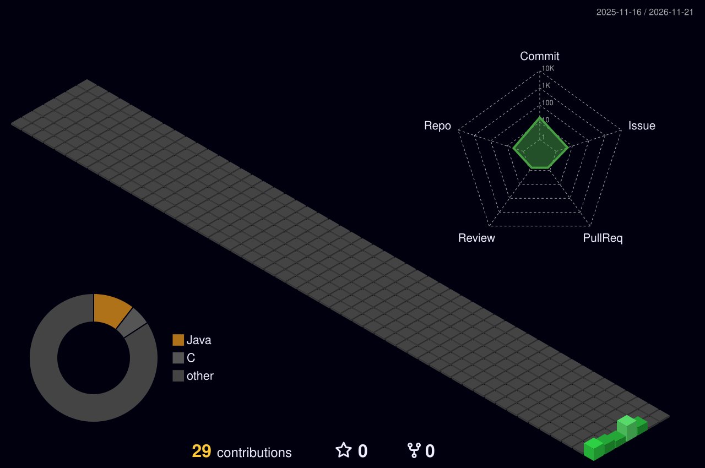

  

## About Me

Hi, I'm **Hiếu** (you can also call me **Oliver**). I'm a first-year **Software Engineering** student at **TAMK** (Tampere University of Applied Sciences) in **Tampere, Finland**, originally from **Vietnam**.

I'm working toward a career in both **Software Engineering** and **AI Engineering**. Right now I'm focused on **data structures & algorithms**, **Java**, and **Machine Learning** comes next. I learn best by building things, so most of what I study ends up as a small project.

<!-- Alongside my studies, I work part-time at **HSIA Việt Nam** on website upkeep and helping colleagues publish content. I speak **Vietnamese** (native), **English** (C1, IELTS 7.5), and **Finnish** (beginner, aiming for C1). -->

---

<!-- ## Featured Projects

<table>
  <tr>
    <td width="50%" valign="top">
      
       
      <b>What:</b> Streamlit app for checking Finnish sentences, looking up vocabulary and practising recurring grammar mistakes 
      <b>Tech:</b> 
      
      
      
      
      
    </td>
    <td width="50%" valign="top">
      
       
      <b>What:</b> Travel booking website demo with flights, hotels, tours and car rental, plus sign-in 
      <b>Tech:</b> 
      
      
      
      
    </td>
  </tr>
  <tr>
    <td width="50%" valign="top">
      
       
      <b>What:</b> Multi-page travel website with destinations, booking and contact pages 
      <b>Tech:</b> 
      
      
    </td>
    <td width="50%" valign="top">
      <b>Coming next</b>  
      Codeforces practice in C++, Python and Java, plus my first Machine Learning projects.
    </td>
  </tr>
</table>

--- -->

## Tech Stack

<table>
  <tr>
    <td width="50%" valign="top">
      <b>Languages</b>  
      
      
      
      
    </td>
    <td width="50%" valign="top">
      <b>Web</b>  
      
      
      
      
    </td>
  </tr>
  <tr>
    <td width="50%" valign="top">
      <b>Data & ML</b>  
      
      
      
      
      
    </td>
    <td width="50%" valign="top">
      <b>Tools</b>  
      
      
      
      
      
      
      
      
    </td>
  </tr>
</table>

## GitHub Analytics

  
  
   
  

---

<!-- 

  

 -->

<h2 align="center">GitHub Analytics</h2>

